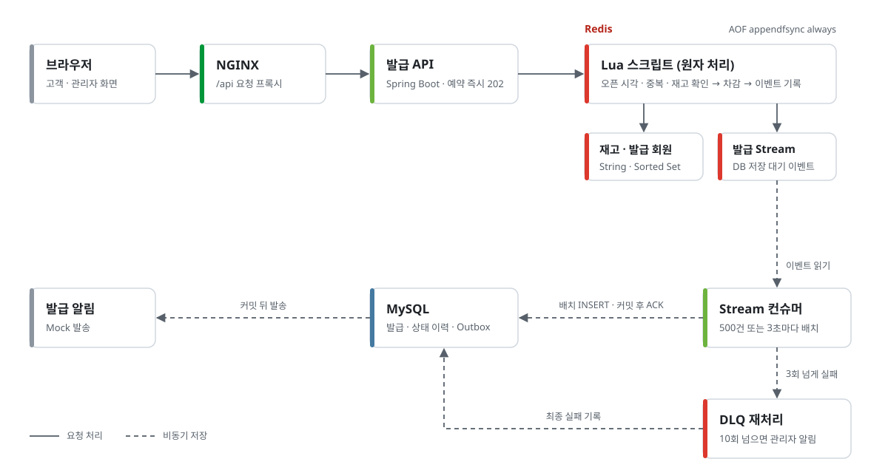
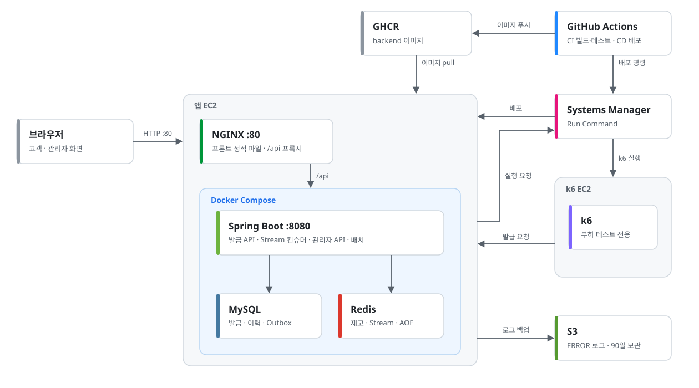

# MOCOU

매주 월요일 10시, 월요병에 걸린 직장인에게 커피 쿠폰을 선착순으로 나눠 주는 서비스를 가정한 쿠폰 발급 백엔드.

[동시성 제어 비교 실험](https://github.com/MO-COU/load-test) · [아키텍처 문서](docs/architecture.md)

## 프로젝트 소개

MOCOU는 Monday Coupon의 약자다. 매주 월요일 정각에 커피 쿠폰 회차를 열고, 회차마다 10,000장을 1인 1매로 선착순 발급한다. 발급된 쿠폰은 14일 동안 쓸 수 있다.

재고 10,000장에 20,000명이 정각에 동시에 요청하는 상황을 기준으로, 다음 세 가지를 지킨다.

- 재고보다 많이 발급하지 않는다.
- 한 회원에게 같은 회차 쿠폰을 두 장 주지 않는다.
- 발급됐다고 응답한 쿠폰은 DB에 반드시 남는다.

## 기술 스택


| 구분 | 기술 | 쓰임 |
|---|---|---|
| 애플리케이션 | Java 21, Spring Boot 4.1.0-RC1, Spring Batch, Gradle 9 | API, 만료 배치 |
| 데이터 | MySQL 8.0, Flyway | 발급·상태 이력 저장, 스키마 이력 |
| 캐시·메시징 | Redis 8.8 | 재고 판정(Lua), 발급 이벤트(Stream), 발급 현황 집계 |
| 테스트 | JUnit 5, Testcontainers, k6 | 실제 MySQL·Redis를 띄운 통합 테스트, 부하 테스트 |
| 인프라 | Docker Compose, AWS EC2·S3·SSM, GHCR | 배포, 오류 로그 보관, 원격 명령 실행 |
| CI/CD | GitHub Actions | 빌드·테스트, 이미지 빌드 후 배포 |

## 시스템 아키텍처



1. 발급 요청이 오면 Lua 스크립트 하나가 오픈 시각, 중복, 재고를 확인하고 재고 차감, 발급 순번, 발급 이벤트(Stream) 기록까지 원자적으로 처리한다.
2. 예약에 성공하면 바로 `202`를 응답한다. 품절·중복·오픈 전은 `409`, 발급 종료 후는 `410`이다.
3. 컨슈머가 Stream을 읽어 500건 또는 3초마다 MySQL에 배치로 저장하고, 커밋한 뒤에 ACK한다.
4. 저장에 실패한 이벤트는 다시 처리하고, 3회를 넘기면 DLQ로 옮긴다. DLQ에서도 10회를 넘기면 실패 기록을 남기고 관리자에게 알린다.

## 인프라 구성



부하 테스트는 앱 서버 자원을 쓰지 않도록 별도 EC2에서 돌린다. 배포와 부하 테스트 실행 모두 SSH 대신 SSM을 쓴다.

## 서비스 흐름

| 주체 | 하는 일 | API |
|---|---|---|
| 관리자 | 회차 생성(재고·오픈 시각) | `POST /api/admin/coupons` |
| 회원 | 발급 요청 | `POST /api/coupons/{couponId}/issues` |
| 회원 | 14일 안에 사용 | `POST /api/coupon-issues/{issueId}/use` |
| 배치 | 기한이 지난 쿠폰 만료 | |
| 관리자 | 발급 현황·DLQ 조회, 정합성 검증·부하 테스트 실행 | `/api/admin/**` |

## 핵심 기능

### 1. 선착순 발급

- 재고 판정을 Redis Lua 스크립트 하나에서 끝내 분산 락 없이 동시 요청을 처리한다.
- 20,000명이 재고 10,000장에 동시에 요청하는 조건에서 6가지 방식을 비교했다. DB에서 재고를 판정한 방식(원자적 UPDATE, 비관적 락, Redisson 분산락, 낙관적 락)은 실패율 57-77%, Redis WATCH는 92%였다. Redis Lua는 실패 0%로 20,000건을 12.0초에 처리하고 재고를 모두 발급했다. 20회 측정 모두 초과·중복 발급은 0건이다([MO-COU/load-test](https://github.com/MO-COU/load-test)).
- 1인 1매는 Redis의 발급 회원 확인과 DB `UNIQUE(coupon_id, member_id)` 두 겹으로 막는다.

### 2. 비동기 저장과 유실 방지

- 응답은 Redis에 예약된 시점에 나가므로, DB에 저장되기 전까지는 Redis가 유일한 기록이다. 운영 Redis는 AOF `appendfsync always`로 매 쓰기를 디스크에 남긴다.
- 컨슈머는 DB 커밋 뒤에만 ACK한다. 재처리로 생기는 중복 저장은 UNIQUE 제약에서 걸러 건너뛴다.
- DLQ에서도 실패한 이벤트는 관리자 API로 조회하고 다시 처리할 수 있다.

### 3. 쿠폰 사용과 만료

- 사용과 만료 모두 `ISSUED` 상태에서만 조건부로 갱신해, 둘이 겹쳐도 먼저 성공한 쪽 하나만 남는다.
- 만료는 Spring Batch로 처리하고 상태 변경과 이력을 함께 기록한다. 청크 크기는 측정으로 2,000건으로 정했다([만료 배치 성능 검증](docs/performance/coupon-expiration-batch.md)).

### 4. 정합성·부하 검증

- 회원 100만·발급 300만·상태 이력 약 599만 건을 한 스냅샷 위에서 중복·초과 발급, 재고, 상태·시각, 이력 체인, 참조 무결성, Redis·DB 대조, 예약 순번 규칙 8개로 검사하고 결과를 PASS·FAIL·ERROR로 남긴다.
- Stream에 처리되지 않은 이벤트가 남아 있으면 Redis 대조는 `ERROR`로 기록해, 판정할 수 없는 상태를 "위반 0"과 구분한다.

```text
쿠폰별 회원 발급 수 ≤ 1
발급 수 ≤ 총 재고
DB 발급 수 + DB 잔여 재고 = 총 재고
Redis 발급 회원 = DB 발급 회원, Redis 재고 = DB 잔여 재고
```

- 전체 검증 시간은 EC2(c5.2xlarge)에서 180초였고, [쿼리 3건 개선](https://github.com/MO-COU/backend/pull/209)과 [MySQL 버퍼 풀 4GB 산정](https://github.com/MO-COU/backend/issues/210)으로 90초가 됐다.
- 같은 앱 EC2에 k6로 20,000 VU를 60초에 걸쳐 늘리면 p95 약 2.0초였고 DB 적재는 k6 종료와 함께 끝났다([측정 기록](https://github.com/MO-COU/backend/issues/168#issuecomment-5467609099)). 한꺼번에 몰리는 조건은 6회 모두 오류 0건이었고, 워커 스레드 200에서 p95는 약 1.2초였다([측정 기록](https://github.com/MO-COU/backend/issues/218)).

## 추가 기능

- **발급 알림**: 저장과 같은 트랜잭션에서 Outbox에 쌓고 커밋 뒤 발송한다. 놓친 건은 폴링으로 다시 보낸다. 발송은 Mock이다.
- **발급 현황**: Redis 결과 카운터와 DB 적재 수를 함께 조회해 비동기 저장 진행 상태를 본다.
- **부하 테스트 실행**: 관리자 API가 SSM으로 k6 EC2에서 테스트를 돌리고 실행 조건과 결과를 DB에 기록한다.
- **오류 로그 백업**: ERROR 로그를 날짜·10MB 단위로 롤링·압축해 매일 S3에 올린다.
- **대용량 데이터 생성**: `datagen` 프로필로 회원 100만·발급 300만 건을 적재한다.

## 프로젝트 구조

```text
src/main/java/com/mocou/
├── issue/          Redis 발급, Stream, 컨슈머
├── consistency/    정합성 검증
├── lifecycle/      쿠폰 사용·만료 배치
├── notification/   Outbox, 알림
├── coupon/         회차 추가·삭제
├── admin/          관리자 API
├── loadtest/       부하 테스트 실행·리셋
├── datagen/        대용량 데이터 생성
├── member/         회원
└── global/         설정, 예외, 응답, 로깅
```

## 테스트

JUnit 5와 Testcontainers로 실제 MySQL·Redis를 띄워 검증한다. 대상은 Lua 발급 판정, Stream 이벤트 생성, 컨슈머의 DB 적재, DLQ 복구, 쿠폰 상태 전이와 만료 배치, Outbox 알림이다. 정합성 규칙은 잘못된 데이터를 일부러 넣어 위반을 잡는지 확인한다.

## 로컬 실행

<details>
<summary>실행 방법</summary>

JDK 21과 Docker(Compose)가 필요하다.

```bash
docker compose up -d                                                # MySQL·Redis
./gradlew bootRun --args='--spring.profiles.active=local,datagen'   # 첫 실행: 회원 100만·발급 300만 적재 후 기동
./gradlew bootRun                                                   # 이후 실행
./gradlew test                                                      # Testcontainers로 MySQL·Redis를 직접 띄운다
```

API 문서: http://localhost:8080/swagger-ui/index.html

</details>

## 문서

- [아키텍처](docs/architecture.md)
- [정합성 검증 규칙](docs/b1/consistency-rules.md) · [대용량 데이터 생성](docs/b1/datagen.md)
- [쿠폰 생명주기 정책](docs/b2/coupon-lifecycle-policy.md) · [쿠폰 만료 배치](docs/b2/coupon-expiration-batch-guide.md)
- [k6 부하 테스트](load-test/README.md) · [오류 로그 운영](docs/operations/system-error-file-logging.md)

## 팀원

| 이름 | 주요 담당 |
|---|---|
| 장근창 (팀장) | 대용량 데이터 생성, Redis-DB 정합성 검증과 검증 쿼리 튜닝, 동시성 제어 비교 실험 설계·측정 |
| 권도하 | 공통 기능 및 배포·운영 환경 |
| 권혁준 | 쿠폰 생명주기, 만료 Batch, Redis 발급 현황, 운영 로그 및 S3 백업 |
| 박서희 | 관리자 API, k6 부하 테스트 및 AWS SSM 기반 실행 |
| 조현빈 | Redis Stream Consumer, 재처리·DLQ, Transactional Outbox |
| 지창민 | Redis Lua 기반 발급, 재고·중복 제어, 발급 순번 및 Redis 상태 관리 |
